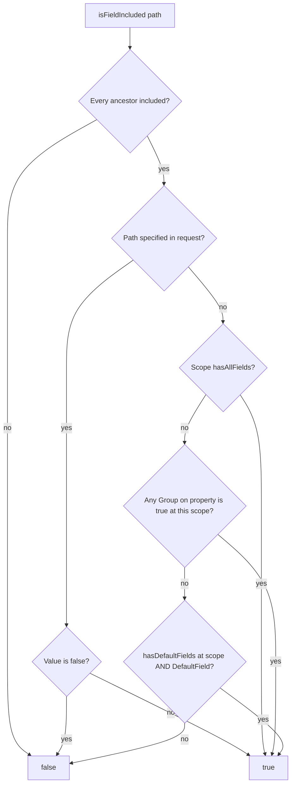
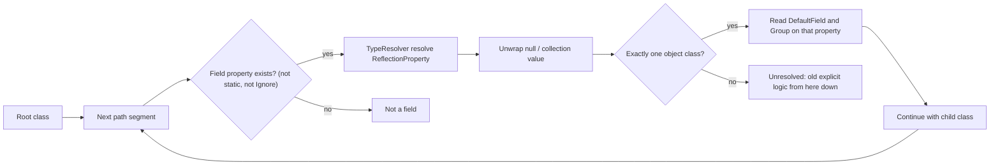

# ADR: Calculated field inclusion via DTO attributes

## Status

Draft (2.0.0)

## Context

`isFieldIncluded()` only inspected the request tree: a path was included if it was present and not `false`.
The library did not know which DTO properties were defaults or members of custom groups, so callers wrote:

```php
return $fieldsOptions->isFieldIncluded($field)
    || $fieldsOptions->hasDefaultFields()
    || $fieldsOptions->hasAllFields();
```

That treats **every** field as requested whenever defaults or `_all` are active.

The object applier had the same gap: without a prototype, `isFieldIncluded()` never sees `#[DefaultField]` / `#[Group]`, so an attributed DTO would export nothing.

## Decision

1. Annotate DTO properties with `#[DefaultField]` and `#[Group('_name')]`.
2. Bind a prototype (instance or class-string) onto `FieldsOptions` so inclusion can be calculated. The usual way is a `Validator` constructed with the DTO / class-string; `FieldsOptions` and `FieldsOptionsBuilder` read it via `ValidatorInterface::getPrototype()`. Custom implementations must supply that method — it is not optional on the interface.
3. Walk nested types with Symfony TypeInfo (`TypeResolver` + `phpstan/phpdoc-parser`) so paths such as `education.institutionName` resolve `EducationDto` from phpdoc without a populated collection.
4. Make `isFieldIncluded()` return the effective result. Keep `isFieldExplicitlyIncluded()` for the old meaning. Keep `hasDefaultFields()` / `hasAllFields()` / `hasGroupField()` on the explicit helper so meta keys stay correct.
5. `FieldsOptionsObjectApplier`:
    - Classes **with** `#[DefaultField]` / `#[Group]` → calculated inclusion.
    - Classes **without** those attributes → legacy `getExportedFields()` defaults.
    - `withPrototype($object)` is an internal safety net on the attributed path: it binds the runtime object if the `FieldsOptions` instance has no prototype. Callers are not expected to use it.

## How a prototype changes `isFieldIncluded()`

Without a prototype, `isFieldIncluded('name')` is “was `name` listed and not `false`, or is `_all` set at that scope?”. Empty request `[]` includes nothing.

With a prototype, the same call is the **effective** answer:

| Request | `id` (`#[DefaultField]`) | `name` (`#[DefaultField]`) | `description` (optional) |
| --- | --- | --- | --- |
| `[]` (implicit defaults) | yes | yes | no |
| `{"id": true}` (field list turns defaults off) | yes | no | no |
| `{"_defaults": true, "description": true}` | yes | yes | yes |
| `{"_all": true}` | yes | yes | yes |
| `{"_all": true, "description": false}` | yes | yes | no |
| `{"_basicInfo": true}` | yes | yes | no |

`hasDefaultFields()` / `hasAllFields()` / `hasGroupField()` stay request-only. They do not look at attributes. Use them to inspect what the client sent, not to decide export.

## Usage

### 1. Annotate the DTO

```php
use Lucian\FieldsOptions\Attribute\DefaultField;
use Lucian\FieldsOptions\Attribute\Group;

class ProfileDto
{
    #[DefaultField]
    #[Group('_basicInfo')]
    public int $id;

    #[DefaultField]
    #[Group('_basicInfo')]
    public string $name;

    #[Group('_extended')]
    public ?string $description = null;

    /** @var EducationDto[] */
    public array $education;
}

class EducationDto
{
    #[DefaultField]
    public int $institutionId;

    #[DefaultField]
    public string $institutionName;
}
```

### 2. Typical: `Validator` supplies the prototype

This is the normal 2.0 setup. A validator built with the response DTO (or class-string) both validates field paths and gives `FieldsOptions` a prototype. After that, `isFieldIncluded()` / `getIncludedFields()` use the table above.

```php
use Lucian\FieldsOptions\FieldsOptions;
use Lucian\FieldsOptions\FieldsOptionsBuilder;
use Lucian\FieldsOptions\Validator;

$validator = new Validator($sampleDto); // or ProfileDto::class

$data = ['id' => true, 'education' => ['_all' => true]];
$options = new FieldsOptions($data, $validator);

// same options, built programmatically
$options = (new FieldsOptionsBuilder($validator))
    ->setFieldIncluded('id')
    ->setAllFieldsIncluded('education')
    ->build();

$options->isFieldIncluded('id');                         // true
$options->getIncludedFields();                           // ['id', 'education']
$options->forField('education')->getIncludedFields();    // ['institutionId', 'institutionName']
```

There is no separate constructor prototype argument. The validator is the single source for both path validation and inclusion schema.

### 3. Nested slices

`forField('education')` keeps the request subtree and the resolved child class (`EducationDto`). You do not pass the child prototype again. The subtree is not re-validated.

```php
$options = new FieldsOptions(['education' => true], $validator);

$child = $options->forField('education');
$child->isFieldIncluded('institutionName'); // true: education:true ⇒ child defaults
$child->isFieldIncluded('missing');         // false
```

`{"education": {"institutionName": true}}` turns child defaults off, so `institutionId` is not included.

### 4. Apply to a response DTO

Use the same `FieldsOptions` you already built with a validator:

```php
$applier = new FieldsOptionsObjectApplier(new SampleExportApplier());
$fieldsOptions = new FieldsOptions($data, $validator);
$applier->apply($profileDto, $fieldsOptions);
```

Unannotated classes keep pre-2.0 behavior (`ExportApplierInterface::getExportedFields()`, e.g. `__exportedProperties`), with the divergences listed under [Compatibility of the applier safety net](#compatibility-of-the-applier-safety-net). A nested mix is allowed (annotated parent, unannotated child): each `apply()` call chooses the path for **that** object.

### 5. `withPrototype()` — internal, rarely for callers

Callers should not need `withPrototype()`. The applier calls it internally on attributed classes so `apply()` still works if it receives a `FieldsOptions` that has no prototype (pre-2.0 construction, or data-only). That situation is unlikely in 2.0 once a `Validator` is in place.

If you already hold a built instance with no prototype and need calculated inclusion without reconstructing it:

```php
$forResponse = $alreadyBuilt->withPrototype($dto); // copies data, does not re-validate
```

The original instance is unchanged and stays explicit-only.

## Compatibility of the applier safety net

`withPrototype()` runs only when the runtime class has `#[DefaultField]` or `#[Group]`. Unannotated DTOs go through `applyLegacy()` and take defaults from `getExportedFields()`. `applyLegacy()` reads the request with `isFieldExplicitlyIncluded()`, not calculated `isFieldIncluded()`, so the list passed to `setExportedFields()` is the same with or without a `Validator` prototype, and the usual 2.0 constructor (`new FieldsOptions($data, new Validator(ProfileDto::class))`) does not append `_all` fields twice.

For unannotated classes that list matches the raw 1.x `setExportedFields()` output for every request shape, except these intentional divergences:

1. **`_all` alone.** A request whose only keys at a level are `_all` (optionally with `_opt`), at the root or nested, passes `null` (export everything). 1.x passed the reflected property list. The output is the same for exporters that treat `null` as “every property”; it can differ when reflection and the exporter disagree on what every property is (e.g. dynamic properties, or statics and bookkeeping fields that 1.x listed).
2. **Static and `#[Ignore]` properties are never passed.** 1.x passed every reflected property, so `_all` or empty-defaults lists included statics and bookkeeping properties such as `__exportedProperties`. A `__`-prefixed property without `#[Ignore]` is a normal field and is still passed.
3. **Uninitialized typed properties no longer crash.** The name is listed when included; the value is not read or traversed. 1.x threw `Error` (“must not be accessed before initialization”).

The caller's `FieldsOptions` is not mutated: `withPrototype()` copies only on the attributed path. If that instance was built with a prototype, later `isFieldIncluded()` on it is still calculated.

The break is opt-in: **add those attributes, and that class leaves the 1.x apply path.** Binding the object is what makes the new path work. Skipping `withPrototype()` when there is no constructor prototype would export an empty list, which is worse than 1.x.

What can go wrong after you add attributes:

1. **Defaults stop coming from the object.** 1.x `apply($dto, new FieldsOptions([]))` returns without calling `setExportedFields()`, so the DTO keeps whatever it already exports. The attributed path always writes the list from attributes. If `#[DefaultField]` does not match `__exportedProperties` (or defaults that depend on runtime state), the JSON changes.
2. **One attribute switches the whole class.** A single `#[Group]` on one property disables `getExportedFields()` for every property. Fields that were defaults only because of `__exportedProperties` disappear from an empty/`_defaults` request unless you also mark them `#[DefaultField]`.
3. **Custom group keys in the request start meaning inclusion.** 1.x (and the legacy path) treat `_basicInfo: true` as a key that matches no property, so `{"_basicInfo": true}` alone exports nothing (`setExportedFields([])`). With `#[Group('_basicInfo')]`, that request includes those properties.
4. **Nested children get a schema they did not have in 1.x.** The attributed path uses `forField()`, which attaches the child class. Unannotated children still use `applyLegacy()`.

The constructor validates field paths against the prototype when a `Validator` with one is supplied. `withPrototype()` and `forField()` bind inclusion schema via `copyWith()` and do not re-validate, so the attributed path does not throw new “invalid field” errors. The legacy path re-validates each child slice with the default structure-only `Validator`, as 1.x did. Invalid `#[Group]` names are a schema error and throw when the prototype is bound (including `withPrototype()` on apply).

**Practical rule:** keep current DTOs unannotated and apply matches 1.x except for the three divergences above. If your DTO base class keeps bookkeeping state in properties (`__exportedProperties`, `__excludedProperties`), mark those declarations `#[Ignore]` once; subclasses that redeclare them stay ignored. When you annotate, treat attributes as the new source of defaults and keep them in sync with `__exportedProperties` (or drop that list for that class). Construct `FieldsOptions` with a `Validator` so the prototype is present from the start.

## Inclusion algorithm



Meta keys (`_defaults`, `_all`, `_opt`, custom groups that are not real properties) skip this graph and stay explicit-only.

Without a prototype the graph stops at “path specified” plus `_all` at that scope. A validator prototype is what enables the group and `DefaultField` steps.

## Nested type walk



Unresolved types: `mixed`, `object`, untyped `array`/`iterable` (no item class), multi-object unions, intersections. TypeInfo cannot parse `\iterable|EducationDto[]|null` as one string; the resolver splits the `@var` union and resolves each part.

`IteratorAggregate` DTOs declared in phpdoc (`@var LocationDto`) are reported as `CollectionType` wrapping the DTO class. If the collection value type is untyped, the wrapped object class is used (so `LocationDto` is not treated as `mixed`).

Scalars (`int`, `string`) are not nestable: `location.cityId.missing` is invalid. `mixed.foo` is accepted.

Static properties and properties marked `#[Ignore]` are not request fields. `NestedTypeResolver::isFieldProperty()` is the single check: `getFieldNames()`, the `#[Group]` walk and both applier paths skip them, and `hasProperty()` is false, so Validator rejects them as paths and the type walk does not descend into them. `#[DefaultField]` / `#[Group]` on an ignored property have no effect (they do not make the class attributed, and its group names are not instantiated). `#[Ignore]` survives redeclaration: it applies when found on the declaration itself, on a trait the declaring class uses (directly or through nested traits), or on the same-named non-private declaration of any ancestor. A subclass cannot un-ignore it by redeclaring. A `private` ancestor declaration is a separate property and does not propagate. The library does not special-case `__`-prefixed names.

## Consequences

- Breaking for callers that treated `isFieldIncluded()` as “explicitly listed”, once a prototype is provided (the usual case: `new Validator($dto)`).
- Direct `isFieldIncluded()` calls without a prototype stay explicit-only, except that a path under `_all` at its scope is now included (`{"_all": true}` makes `isFieldIncluded('name')` true; 1.x returned false).
- `getIncludedFields()` is schema-calculated once a prototype is bound and explicit-keys-only (meta keys such as `_defaults` included, as in 1.x) otherwise. Callers that use it directly get different results after they start passing a `Validator` prototype. The legacy applier path does not use it.
- `Builder::build()` forwards the validator prototype, so builder users with `new Validator($dto)` (or any `ValidatorInterface` whose `getPrototype()` returns an object/class-string) get calculated inclusion without extra steps.
- `withPrototype()` is not a primary API. The applier uses it internally; callers would only need it for an already-built instance that has no prototype.
- Type-resolution caches are per instance: `NestedTypeResolver` (`classCache`, `propertyClassCache`, `propertyKindCache`, `fieldPropertyCache`, `fieldNamesCache`) and `FieldSchemaCache` (group names per property). `FieldsOptions` creates one resolver and one schema cache when a prototype is first bound (constructor or `withPrototype()`) and threads both through `forField()` / `withPrototype()` and the legacy child slices. The applier therefore reuses reflection/phpdoc results across a collection instead of re-parsing every object. Unrelated `FieldsOptions` instances do not share a resolver or schema cache.
- Process-wide caches are limited to facts that cannot change within a process: the set of classes whose reachable graph has valid `#[Group]` names (`FieldSchema`, see below) and the `#[Ignore]` verdict per property declaration (`NestedTypeResolver`).
- `#[Group]` names are validated eagerly when a prototype is bound, so a bad name fails at bind time instead of on some later request. `FieldSchema` walks every class reachable from the root and instantiates each `#[Group]`. The walk resolves property types, which is not free: on the test fixtures, the first bind of the five-class `RootDto` graph took about 1.5–2.5 ms (Xdebug off, library already loaded) and the two-class `ProfileDto` above under 0.2 ms. The result is memoized process-wide per class and committed only after the whole reachable graph validated; later binds of a memoized class skip the walk (about 0.01 ms). A class with an invalid name is never memoized and throws on every bind. The memo holds no type information: a later `FieldsOptions` for the same class starts with an empty resolver and resolves the types of the paths it actually queries on first use.
- `FieldsOptionsObjectApplier` decides attributed vs legacy apply with a per-instance map of “class declares `#[DefaultField]` / `#[Group]`”, capped by `MAX_REFLECTION_CACHE_SIZE` like the per-class field property list (`fieldPropertiesCache`). That check is not stored on `FieldSchema`.
- New dependencies: `symfony/type-info` `^7.4 || ^8.0`, `phpstan/phpdoc-parser`. Type-info 7.4 (PHP >=8.2) is what this library locks so `composer install` works on PHP 8.3; 8.x requires PHP >=8.4. Type-info 7.4 installs beside Symfony 5.4/6.4 unless Flex `extra.symfony.require` pins all `symfony/*` packages.
- Validator is stricter on nested collections when phpdoc names the item class, and rejects static and `#[Ignore]` property names as paths (1.x accepted any declared property). Request keys starting with `_` are still read as group keys and are not path-validated.
- Invalid `#[Group]` names (`basicInfo`, `_defaults`, `_all`, `_opt`) throw `InvalidArgumentException` when the prototype is bound (`FieldSchema` construction walks the DTO graph). Because binding already threw, an invalid name never surfaces from `isFieldIncluded()`.
- `__`-prefixed property names are no longer special-cased (earlier 2.0 drafts skipped them in some places). Consumers whose DTO base class keeps bookkeeping state in properties add `#[Ignore]` on those base-class declarations.
