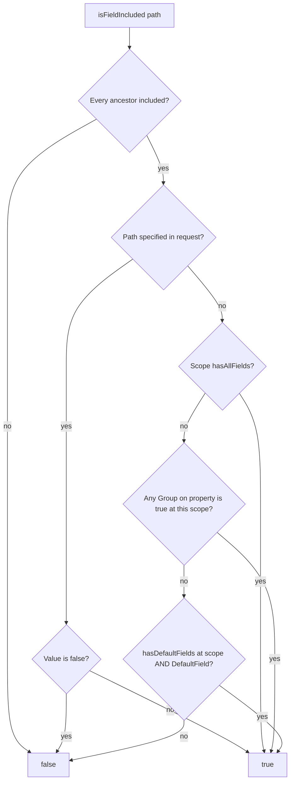
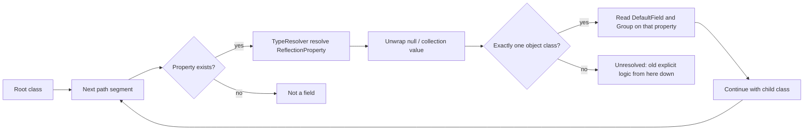

# ADR: Calculated field inclusion via DTO attributes

## Status

Draft (2.0.0)

## Context

`isFieldIncluded()` only inspected the request tree: a path was included if it was present and not `false`.
The library did not know which DTO properties were defaults or members of custom groups, so callers wrote:

```php
return $fieldsOptions->isFieldIncluded($field)
    || $fieldsOptions->hasDefaultFields()
    || $fieldsOptions->hasAllFields();
```

That treats **every** field as requested whenever defaults or `_all` are active.

The object applier had the same gap: without a prototype, `isFieldIncluded()` never sees `#[DefaultField]` / `#[Group]`, so an attributed DTO would export nothing.

## Decision

1. Annotate DTO properties with `#[DefaultField]` and `#[Group('_name')]`.
2. Bind a prototype (instance or class-string) onto `FieldsOptions` so inclusion can be calculated. The usual way is a `Validator` constructed with the DTO / class-string; `FieldsOptions` and `FieldsOptionsBuilder` read it from there.
3. Walk nested types with Symfony TypeInfo (`TypeResolver` + `phpstan/phpdoc-parser`) so paths such as `education.institutionName` resolve `EducationDto` from phpdoc without a populated collection.
4. Make `isFieldIncluded()` return the effective result. Keep `isFieldExplicitlyIncluded()` for the old meaning. Keep `hasDefaultFields()` / `hasAllFields()` / `hasGroupField()` on the explicit helper so meta keys stay correct.
5. `FieldsOptionsObjectApplier`:
    - Classes **with** `#[DefaultField]` / `#[Group]` → calculated inclusion.
    - Classes **without** those attributes → legacy `getExportedFields()` defaults.
    - `withPrototype($object)` is an internal safety net on the attributed path: it binds the runtime object if the `FieldsOptions` instance has no prototype. Callers are not expected to use it.

## How a prototype changes `isFieldIncluded()`

Without a prototype, `isFieldIncluded('name')` is still “was `name` listed and not `false`?”. Empty request `[]` includes nothing.

With a prototype, the same call is the **effective** answer:

| Request | `id` (`#[DefaultField]`) | `name` (`#[DefaultField]`) | `description` (optional) |
| --- | --- | --- | --- |
| `[]` (implicit defaults) | yes | yes | no |
| `{"id": true}` (field list turns defaults off) | yes | no | no |
| `{"_defaults": true, "description": true}` | yes | yes | yes |
| `{"_all": true}` | yes | yes | yes |
| `{"_all": true, "description": false}` | yes | yes | no |
| `{"_basicInfo": true}` | yes | yes | no |

`hasDefaultFields()` / `hasAllFields()` / `hasGroupField()` stay request-only. They do not look at attributes. Use them to inspect what the client sent, not to decide export.

## Usage

### 1. Annotate the DTO

```php
use Lucian\FieldsOptions\Attribute\DefaultField;
use Lucian\FieldsOptions\Attribute\Group;

class ProfileDto
{
    #[DefaultField]
    #[Group('_basicInfo')]
    public int $id;

    #[DefaultField]
    #[Group('_basicInfo')]
    public string $name;

    #[Group('_extended')]
    public ?string $description = null;

    /** @var EducationDto[] */
    public array $education;
}

class EducationDto
{
    #[DefaultField]
    public int $institutionId;

    #[DefaultField]
    public string $institutionName;
}
```

### 2. Typical: `Validator` supplies the prototype

This is the normal 2.0 setup. A validator built with the response DTO (or class-string) both validates field paths and gives `FieldsOptions` a prototype. After that, `isFieldIncluded()` / `getIncludedFields()` use the table above.

```php
use Lucian\FieldsOptions\FieldsOptions;
use Lucian\FieldsOptions\FieldsOptionsBuilder;
use Lucian\FieldsOptions\Validator;

$validator = new Validator($sampleDto); // or ProfileDto::class

$options = new FieldsOptions($data, $validator);

$options = (new FieldsOptionsBuilder($validator))
    ->setFieldIncluded('id')
    ->setAllFieldsIncluded('profile.education')
    ->build();

$options->isFieldIncluded('id');
$options->getIncludedFields();
$options->forField('education')->getIncludedFields();
```

Passing the prototype as a third constructor argument is equivalent when you already have a class-string and no extra validator logic:

```php
$options = new FieldsOptions($data, null, ProfileDto::class);
```

### 3. Nested slices

`forField('education')` keeps the request subtree and the resolved child class (`EducationDto`). You do not pass the child prototype again.

```php
$options = new FieldsOptions(['education' => true], $validator);

$child = $options->forField('education');
$child->isFieldIncluded('institutionName'); // true: education:true ⇒ child defaults
$child->isFieldIncluded('missing');         // false
```

`{"education": {"institutionName": true}}` turns child defaults off, so `institutionId` is not included.

### 4. Apply to a response DTO

Use the same `FieldsOptions` you already built with a validator:

```php
$applier = new FieldsOptionsObjectApplier(new SampleExportApplier());
$fieldsOptions = new FieldsOptions($data, $validator);
$applier->apply($profileDto, $fieldsOptions);
```

Unannotated classes keep pre-2.0 behavior (`ExportApplierInterface::getExportedFields()`, e.g. `__exportedProperties`). A nested mix is allowed (annotated parent, unannotated child): each `apply()` call chooses the path for **that** object.

### 5. `withPrototype()` — internal, rarely for callers

Callers should not need `withPrototype()`. The applier calls it internally on attributed classes so `apply()` still works if it receives a `FieldsOptions` that has no prototype (pre-2.0 construction, or data-only). That situation is unlikely in 2.0 once a `Validator` is in place.

If you already hold a built instance with no prototype and need calculated inclusion without reconstructing it:

```php
$forResponse = $alreadyBuilt->withPrototype($dto); // copies data, does not re-validate
```

The original instance is unchanged and stays explicit-only.

## Compatibility of the applier safety net

Existing 1.x applier usage does **not** change. `withPrototype()` runs only when the runtime class has `#[DefaultField]` or `#[Group]`. Unannotated DTOs still go through `applyLegacy()` and still take defaults from `getExportedFields()`. The original `FieldsOptions` is cloned, so later `isFieldIncluded()` on that instance stays explicit-only.

The break is opt-in: **add those attributes, and that class leaves the 1.x apply path.** Binding the object is what makes the new path work. Skipping `withPrototype()` when there is no constructor prototype would export an empty list, which is worse than 1.x.

What can go wrong after you add attributes:

1. **Defaults stop coming from the object.** 1.x `apply($dto, new FieldsOptions([]))` returns without calling `setExportedFields()`, so the DTO keeps whatever it already exports. The attributed path always writes the list from attributes. If `#[DefaultField]` does not match `__exportedProperties` (or defaults that depend on runtime state), the JSON changes.
2. **One attribute switches the whole class.** A single `#[Group]` on one property disables `getExportedFields()` for every property. Fields that were defaults only because of `__exportedProperties` disappear from an empty/`_defaults` request unless you also mark them `#[DefaultField]`.
3. **Custom group keys in the request start meaning inclusion.** 1.x treated `_basicInfo: true` as an unrelated key. With `#[Group('_basicInfo')]`, that request includes those properties.
4. **Nested children get a schema they did not have in 1.x.** The attributed path uses `forField()`, which attaches the child class. Unannotated children still use `applyLegacy()`.
5. **`_all: true` alone.** Attributed path calls `setExportedFields(null)` (export everything). Legacy lists reflected properties. They match in typical DTOs; they differ if reflection and `get_object_vars()` / `propertyExists()` do not see the same fields.

`withPrototype()` does not re-validate, so apply does not throw new “invalid field” errors.

**Practical rule:** keep current DTOs unannotated and 1.x apply stays identical. When you annotate, treat attributes as the new source of defaults and keep them in sync with `__exportedProperties` (or drop that list for that class). Construct `FieldsOptions` with a `Validator` so the prototype is present from the start.

## Inclusion algorithm



Meta keys (`_defaults`, `_all`, `_opt`, custom groups that are not real properties) skip this graph and stay explicit-only.

Without a prototype the graph stops at “path specified” plus `_all` at that scope. A validator (or constructor) prototype is what enables the group and `DefaultField` steps.

## Nested type walk



Unresolved types: `mixed`, `object`, untyped `array`/`iterable` (no item class), multi-object unions, intersections. TypeInfo cannot parse `\iterable|EducationDto[]|null` as one string; the resolver splits the `@var` union and resolves each part.

`IteratorAggregate` DTOs are reported as `CollectionType` wrapping the DTO class. If the collection value type is untyped, the wrapped object class is used (so `LocationDto` is not treated as `mixed`).

Scalars (`int`, `string`) are not nestable: `location.cityId.missing` is invalid. `mixed.foo` is accepted.

## Consequences

- Breaking for callers that treated `isFieldIncluded()` as “explicitly listed”, once a prototype is provided (the usual case: `new Validator($dto)`).
- Direct `isFieldIncluded()` calls without a prototype stay explicit-only.
- `Builder::build()` forwards the validator prototype, so builder users with `new Validator($dto)` get calculated inclusion without extra steps.
- `withPrototype()` is not a primary API. The applier uses it internally; callers would only need it for an already-built instance that has no prototype.
- New dependencies: `symfony/type-info` `^7.4 || ^8.0`, `phpstan/phpdoc-parser`. Type-info 7.4 (PHP >=8.2) is what this library locks so `composer install` works on PHP 8.3; 8.x requires PHP >=8.4. Type-info 7.4 installs beside Symfony 5.4/6.4 unless Flex `extra.symfony.require` pins all `symfony/*` packages.
- Validator is stricter on nested collections when phpdoc names the item class.
