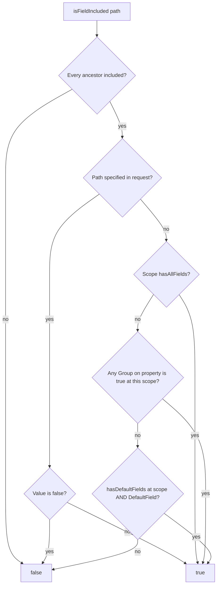
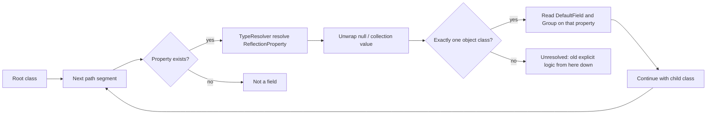

# ADR: Calculated field inclusion via DTO attributes

## Status

Draft (2.0.0)

## Context

`isFieldIncluded()` only inspected the request tree: a path was included if it was present and not `false`.
The library did not know which DTO properties were defaults or members of custom groups, so callers wrote:

```php
return $fieldsOptions->isFieldIncluded($field)
    || $fieldsOptions->hasDefaultFields()
    || $fieldsOptions->hasAllFields();
```

That treats **every** field as requested whenever defaults or `_all` are active.

## Decision

1. Annotate DTO properties with `#[DefaultField]` and `#[Group('_name')]`.
2. Pass a prototype (instance or class-string) into `FieldsOptions`.
3. Walk nested types with Symfony TypeInfo (`TypeResolver` + `phpstan/phpdoc-parser`) so paths such as `education.institutionName` resolve `EducationDto` from phpdoc without a populated collection.
4. Make `isFieldIncluded()` return the effective result. Keep `isFieldExplicitlyIncluded()` for the old meaning. Keep `hasDefaultFields()` / `hasAllFields()` / `hasGroupField()` on the explicit helper so meta keys stay correct.
5. Keep `FieldsOptionsObjectApplier` on `getExportedFields()` for classes that do not declare the attributes.

## Inclusion algorithm



Meta keys (`_defaults`, `_all`, `_opt`, custom groups that are not real properties) skip this graph and stay explicit-only.

## Nested type walk



Unresolved types: `mixed`, multi-object unions, intersections, collections with no item class. TypeInfo cannot parse `\iterable|EducationDto[]|null` as one string; the resolver splits the `@var` union and resolves each part.

`IteratorAggregate` DTOs are reported as `CollectionType` wrapping the DTO class. If the collection value type is untyped, the wrapped object class is used (so `LocationDto` is not treated as `mixed`).

Scalars (`int`, `string`) are not nestable: `location.cityId.missing` is invalid. `mixed.foo` is accepted.

## Applier dual path

- No `DefaultField` / `Group` on the runtime class → legacy `getExportedFields()` defaults (pre-2.0).
- Attributes present → `isFieldIncluded()` + `forField()`.
- Nested mix: each `apply()` call chooses the path for **that** object.

## Consequences

- Breaking for callers that treated `isFieldIncluded()` as “explicitly listed”, once a prototype is provided.
- `Builder::build()` now forwards the validator prototype, so builder users with `new Validator($dto)` get calculated inclusion.
- New dependencies: `symfony/type-info` `^7.4 || ^8.0`, `phpstan/phpdoc-parser`. Type-info 7.4 installs beside Symfony 5.4/6.4 unless Flex `extra.symfony.require` pins all `symfony/*` packages.
- Validator is stricter on nested collections when phpdoc names the item class.
